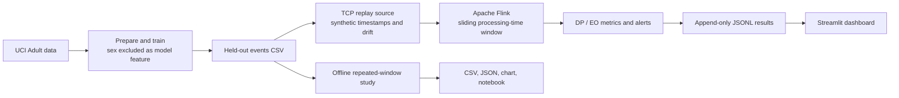

# Streaming Fairness Monitor

**Real-time bias monitoring for a loan-approval service, built on Apache Flink sliding windows.**

Streaming Fairness Monitor replays the UCI Adult Income data as a live event stream, computes **Demographic Parity (DP)** and **Equal Opportunity (EO)** gaps over sliding windows in Apache Flink, raises alerts when bias emerges, shows everything on a Streamlit dashboard, and studies how **window size** trades off **false alarms** against **detection speed**.

*Course project: Big Data Systems & Responsible AI Engineering, Topic 9 (Track B).*

> **Important:** UCI Adult is an *income-classification* dataset, not real credit decisions. This project simulates a loan-decision proxy from predicted income and injects a controlled discriminatory shift. It is an educational demonstration, not a deployed lending system.

---

## Team

| Name | SRN |
|---|---|
| Shubham Bhat | PES1UG24AM273 |
| Satyanarayana Kallakuri | PES1UG24AM257 |
| Shamanth SK | PES1UG24AM258 |

---

## Table of Contents

1. [Problem Statement](#problem-statement)
2. [Deliverables](#deliverables)
3. [Architecture](#architecture)
4. [Quick Start](#quick-start)
5. [Metrics](#metrics)
6. [Window-Size Trade-off Study](#window-size-trade-off-study)
7. [Configuration](#configuration)
8. [Repository Structure](#repository-structure)
9. [Testing](#testing)
10. [Known Limitations](#known-limitations)
11. [Dataset and Attribution](#dataset-and-attribution)

---

## Problem Statement

A loan-approval service must watch for **emerging bias** in its decisions. We replay the Adult Income data as a stream, then:

- compute **demographic parity** and **equal opportunity** in **sliding windows using Flink**;
- build a **dashboard** and **alerts**;
- study how **window size** affects **false alarms** and **detection speed**.

---

## Deliverables

Submission format: **Option A (GitHub repository, packaged as a zip).**

| # | Deliverable | Location in repository | Notes |
|---|---|---|---|
| 1 | **Reproducible pipeline** (scripts + Docker Compose) | [`docker-compose.yml`](docker-compose.yml), [`Dockerfile.flink`](Dockerfile.flink), [`scripts/`](scripts/) (`setup_windows.ps1`, `setup_mac_linux.sh`), [`src/`](src/), [`requirements.txt`](requirements.txt), [`requirements-dashboard.txt`](requirements-dashboard.txt) | One command starts the full stack: `docker compose up --build` |
| 2 | **Results notebook** | [`notebooks/results.ipynb`](notebooks/results.ipynb) | Reproducible analyses and figures |
| 3 | **Technical report** (3 to 5 pages) | [`report/technical_report.pdf`](report/technical_report.pdf) | 4-page report |
| 4 | **Model / data card** | [`docs/DATA_MODEL_CARD.md`](docs/DATA_MODEL_CARD.md) | Source, limitations, risks, model card |
| 5 | **3-minute demo video** | [`streaming_fairness_monitor_silent_demo.mp4`](demo/streaming_fairness_monitor_silent_demo.mp4) | Evaluated in class; need not be submitted. See [`demo/VIDEO_NOTES.md`](demo/VIDEO_NOTES.md) |

Supporting documents:

| Document | Location |
|---|---|
| README with architecture diagram and setup steps | this file |
| Step-by-step installation and troubleshooting | [`docs/INSTALLATION.md`](docs/INSTALLATION.md) |
| 3-minute classroom demo walkthrough | [`docs/DEMO_SCRIPT.md`](docs/DEMO_SCRIPT.md) |
| Automated tests | [`tests/test_metrics.py`](tests/test_metrics.py) |
| Study output (synthetic pilot) | [`results/study_synthetic.csv`](results/study_synthetic.csv) |

> **About the video:** `demo/streaming_fairness_monitor_3min_demo.mp4` is a narrated overview of about 3 minutes, based on the project files and the reproducible synthetic pilot. It is a presentation video, **not** a live screen recording of the running application. For a live demo, follow `docs/DEMO_SCRIPT.md`.

---

## Architecture



| Stage | Component | Description |
|---|---|---|
| Data preparation | `src/prepare_data.py` | Downloads UCI Adult, makes a deterministic train / held-out split, trains a proxy classifier with **sex excluded as a feature** |
| Replay | `src/replay.py` | Streams held-out events over TCP at an adjustable rate and injects a controlled bias shift |
| Stream processing | `src/flink_job.py` | Apache Flink sliding-window computation of DP and EO, plus alarm generation |
| Metrics | `src/fairness.py` | Unit-tested fairness formulas and minimum-support checks |
| Dashboard | `src/dashboard.py` | Streamlit view of live metrics and alerts |
| Study | `src/study.py` | Window-size trade-off evaluation on a controlled replay |

---

## Quick Start

### Prerequisites

- [Python 3.11](https://www.python.org/downloads/)
- [Docker Desktop](https://www.docker.com/products/docker-desktop/) (WSL 2 enabled on Windows), running, with at least **6 GB RAM** available
- [Git](https://git-scm.com/downloads)

### Windows 11 (PowerShell, from the project folder)

```powershell
powershell -ExecutionPolicy Bypass -File .\scripts\setup_windows.ps1
docker compose up --build
```

### macOS / Linux

```bash
bash scripts/setup_mac_linux.sh
docker compose up --build
```

If the `py -3.11` launcher is unavailable, install Python 3.11 and follow [`docs/INSTALLATION.md`](docs/INSTALLATION.md) manually.

### What you should see

| Service | URL |
|---|---|
| Streamlit dashboard | <http://localhost:8501> |
| Flink web UI | <http://localhost:8081> |

The replayer starts once Flink connects. Expect the first non-empty window after roughly 20 seconds (build and startup times vary). Replay ends automatically and the dashboard keeps the completed results.

### Clean restart

1. Stop with `Ctrl+C`.
2. Run `docker compose down`.
3. Delete `results/live.jsonl`.
4. Run `docker compose up --build`.

---

## Metrics

Let *ŷ* be the predicted approval and *Y* the true label.

| Metric | Definition |
|---|---|
| **DP gap** | `P(ŷ = 1 \| Male) − P(ŷ = 1 \| Female)` |
| **EO gap** | `P(ŷ = 1 \| Y = 1, Male) − P(ŷ = 1 \| Y = 1, Female)` |

- A **positive gap favors Male.**
- **Minimum support:** at least **10** observations per group for DP and **5** truly positive observations per group for EO. Below that, the dashboard shows a missing value instead of a misleading zero.
- **Alert rule:** Flink alerts when the **absolute difference from the configured reference** reaches `ALERT_THRESHOLD` (default `0.12`). The Docker defaults use a **zero-gap target**, not an empirically calibrated baseline. The offline study separately estimates a baseline from pre-drift windows.

---

## Window-Size Trade-off Study

Small windows react quickly but are noisy, which causes false alarms. Large windows are stable but slow to notice a real shift. The study measures both effects.

```powershell
.\.venv\Scripts\python.exe -m src.study --dataset synthetic --out results/study_synthetic.csv
.\.venv\Scripts\python.exe -m src.study --dataset adult --file data/events.csv --out results/study_adult.csv
.\.venv\Scripts\python.exe -m jupyter notebook notebooks/results.ipynb
```

| Setting | Synthetic pilot | Adult run |
|---|---|---|
| Data | 8,000 simulated rows | Held-out UCI rows, split in half |
| Bias injection | Halfway through the stream | Halfway through the stream |
| Window sizes | 200 / 500 / 1000 / 2000 **events** | as configured in `src/study.py` |
| Slide | 100 events | as configured in `src/study.py` |
| Threshold | 0.13 | as configured in `src/study.py` |
| Seed | 42 | as configured in `src/study.py` |

**Caveat:** the study uses **event-count** windows, while the Flink job uses **processing-time (seconds)** windows, so the two are not identical experiments. Detection delay is measured in **events after drift onset**, not wall-clock seconds. `results/study_synthetic.csv` holds simulated data, **not** Adult measurements.

---

## Configuration

| Where | What to edit |
|---|---|
| `docker-compose.yml`, service `jobsubmit` | `WINDOW_SECONDS`, `SLIDE_SECONDS`, `ALERT_THRESHOLD`, `REFERENCE_DP`, `REFERENCE_EO`, `MIN_GROUP`, `MIN_POSITIVE` |
| `docker-compose.yml`, service `replayer` (arguments) | `--rate`, `--loops`, `--drift-fraction` |

---

## Repository Structure

```text
Streaming-Fairness-Monitor/
├── README.md
├── docker-compose.yml          # Full stack: Flink, replayer, dashboard
├── Dockerfile.flink            # Flink image with PyFlink
├── requirements.txt
├── requirements-dashboard.txt
├── .gitignore
├── src/
│   ├── prepare_data.py         # Download, split, train proxy classifier
│   ├── replay.py               # TCP replay with bias injection
│   ├── flink_job.py            # Flink sliding-window DP / EO job
│   ├── fairness.py             # Metric formulas and support checks
│   ├── dashboard.py            # Streamlit dashboard and alerts
│   └── study.py                # Window-size trade-off study
├── scripts/                    # setup_windows.ps1, setup_mac_linux.sh
├── notebooks/
│   └── results.ipynb           # Results notebook
├── report/
│   └── technical_report.pdf    # Technical report
├── docs/
│   ├── DATA_MODEL_CARD.md      # Data and model card
│   ├── INSTALLATION.md         # Installation and troubleshooting
│   └── DEMO_SCRIPT.md          # Demo walkthrough
├── demo/
│   ├── streaming_fairness_monitor_3min_demo.mp4
│   └── VIDEO_NOTES.md
├── results/                    # study_synthetic.csv, live.jsonl (runtime)
├── data/                       # Downloaded and prepared data (not committed)
└── tests/
    └── test_metrics.py
```

---

## Testing

```bash
python -m pytest -q
```

Tests cover metric correctness and repeatability (`tests/test_metrics.py`). GitHub upload instructions are in [`docs/INSTALLATION.md`](docs/INSTALLATION.md).

---

## Known Limitations

- The pipeline uses Flink's **socket source** and a file-writing Python map as a **local demo sink**. It is not an exactly-once production sink, and a job restart can duplicate outputs.
- Socket replay terminates, so the Flink job can fail or end when the TCP connection closes, depending on source behavior.
- **Processing-time** windows fluctuate with machine load.
- The dataset is old US Census data with limited, binary group categories. Gaps shown here do not establish a legal finding of discrimination.
- The dashboard needs a manual refresh.
- **For production use:** Kafka, event-time watermarks, a checkpointed transactional sink, confidence intervals, fairness review, and real consented lending records.

---

## Dataset and Attribution

Becker, B. & Kohavi, R. (1996). *Adult* [Dataset]. UCI Machine Learning Repository. DOI: [10.24432/C5XW20](https://doi.org/10.24432/C5XW20). Licensed CC BY 4.0.

The source data is downloaded by the setup script and is not distributed in this repository. The model and metrics are for educational use only.
