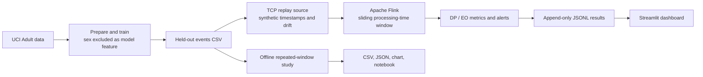

# Streaming Fairness Monitor

A reproducible student project demonstrating **Apache Flink processing-time sliding windows**, live demographic parity and equal opportunity monitoring, triggered alerts, a Streamlit dashboard, and a window-size experiment.

> **Important**: UCI Adult is an **income classification dataset**, not actual credit/loan decisions. This project **simulates** a loan decision proxy from predicted income and injects a controlled discriminatory shift. It is an educational demonstration, not a deployed lending system.

## Architecture



## Quick start (Windows 11)

Install [Python 3.11](https://www.python.org/downloads/), [Docker Desktop](https://www.docker.com/products/docker-desktop/) (WSL 2 enabled), and [Git](https://git-scm.com/downloads). Make sure Docker Desktop is actually running and has at least 6 GB RAM available. Open **PowerShell** in the extracted project folder.

```powershell
powershell -ExecutionPolicy Bypass -File .\scripts\setup_windows.ps1
docker compose up --build
```

If PowerShell's `py -3.11` command is not available, use an installed Python 3.11 and follow `docs/INSTALLATION.md` manually.

Open **http://localhost:8501** for the dashboard and **http://localhost:8081** for the Flink UI. The replayer starts when Flink connects. You should see a first nonempty window after approximately 20 seconds, but startup and build times vary. Replay ends automatically, and the dashboard retains the completed results.

**macOS / Linux:** `bash scripts/setup_mac_linux.sh` then `docker compose up --build`.

**To restart a clean run:** stop with Ctrl+C, run `docker compose down`, delete `results/live.jsonl`, then `docker compose up --build`.

## Included demonstration video

The `demo/streaming_fairness_monitor_3min_demo.mp4` video is a narrated, approximately 3-minute overview based on project files and the reproducible synthetic pilot. **It is a presentation video, not a live application screen recording**. See `demo/VIDEO_NOTES.md` and `docs/DEMO_SCRIPT.md` for an authentic live demo walkthrough.

## Full output files and reports

| Path | Purpose |
|---|---|
| `src/prepare_data.py` | UCI download, deterministic training/held-out split and proxy classifier |
| `src/replay.py` | TCP replay with adjustable rate and controlled bias injection |
| `src/flink_job.py` | Actual Flink sliding-window computation and alarm generation |
| `src/fairness.py` | Unit-tested fairness formulas and support checks |
| `src/dashboard.py` | Streamlit dashboard and alerts |
| `src/study.py` | Window trade-off evaluator on controlled simulated replay |
| `notebooks/results.ipynb` | Reproducible analyses/figures |
| `report/technical_report.pdf` | 4-page technical report |
| `docs/DATA_MODEL_CARD.md` | Source, limitations, risk, model card |
| `docs/INSTALLATION.md` | Step-by-step installation and troubleshooting |
| `docs/DEMO_SCRIPT.md` | 3-minute classroom demo walkthrough |
| `tests/test_metrics.py` | Automated correctness and repeatability checks |
| `results/study_synthetic.csv` | Reproducible synthetic pilot, not Adult measurements |

## Metrics

`DP gap = P(predicted approval | Male) − P(predicted approval | Female)`.

`EO gap = P(predicted approval | true positive label, Male) − P(predicted approval | true positive label, Female)`.

A positive gap favors Male. Groups require at least 10 observations for DP and 5 truly positive observations for EO. Smaller groups display missing metrics instead of misleading zeros. Flink alerts when the **absolute difference from the configured reference** reaches `ALERT_THRESHOLD` (default `0.12`); Docker defaults to a **zero-gap target**, not an empirically calibrated baseline. The offline study separately estimates a baseline reference using pre-drift windows.

## Trade-off experiment

```powershell
.\.venv\Scripts\python.exe -m src.study --dataset synthetic --out results/study_synthetic.csv
.\.venv\Scripts\python.exe -m src.study --dataset adult --file data/events.csv --out results/study_adult.csv
.\.venv\Scripts\python.exe -m jupyter notebook notebooks/results.ipynb
```

Synthetic pilot uses 8,000 simulated rows, injecting a bias shift halfway through, windows of 200/500/1000/2000 **events**, a slide of 100 events, threshold 0.13, and seed 42. Adult version uses the held-out UCI rows, split in half and injected. These are event-count offline windows, contrasted with Flink's **processing-time (seconds)** sliding windows; they should not be treated as identical experiments. The first alarm delay is measured in **events** after drift onset, not wall-clock seconds.

## Environment configuration

Edit `docker-compose.yml` under `jobsubmit`: `WINDOW_SECONDS`, `SLIDE_SECONDS`, `ALERT_THRESHOLD`, `REFERENCE_DP`, `REFERENCE_EO`, `MIN_GROUP`, `MIN_POSITIVE`. Edit `replayer` arguments: `--rate`, `--loops`, `--drift-fraction`.

## Known limitations

This uses Flink's socket source and a file-writing Python map as a **local demo sink**, not an exactly-once production sink; a job restart can duplicate outputs. Socket replay terminates, so the Flink job can fail or end when the TCP connection closes, depending on source behavior. Processing-time windows fluctuate with machine load. The dataset is old US Census data; group categories are limited and binary. Correlation or gaps here do not establish a legal finding of discrimination. The dashboard needs manual Refresh. For production use Kafka, event-time watermarks, checkpointed transactional sink, confidence intervals, fairness review and real consented lending records.

## Dataset and attribution

Becker, B. & Kohavi, R. (1996). *Adult* [Dataset], UCI ML Repository, DOI [10.24432/C5XW20](https://doi.org/10.24432/C5XW20), CC BY 4.0. The source data is downloaded by the setup script and not distributed in the repository. The model and metrics are educational.

## Tests

`python -m pytest -q`. GitHub upload directions: `docs/INSTALLATION.md`.
